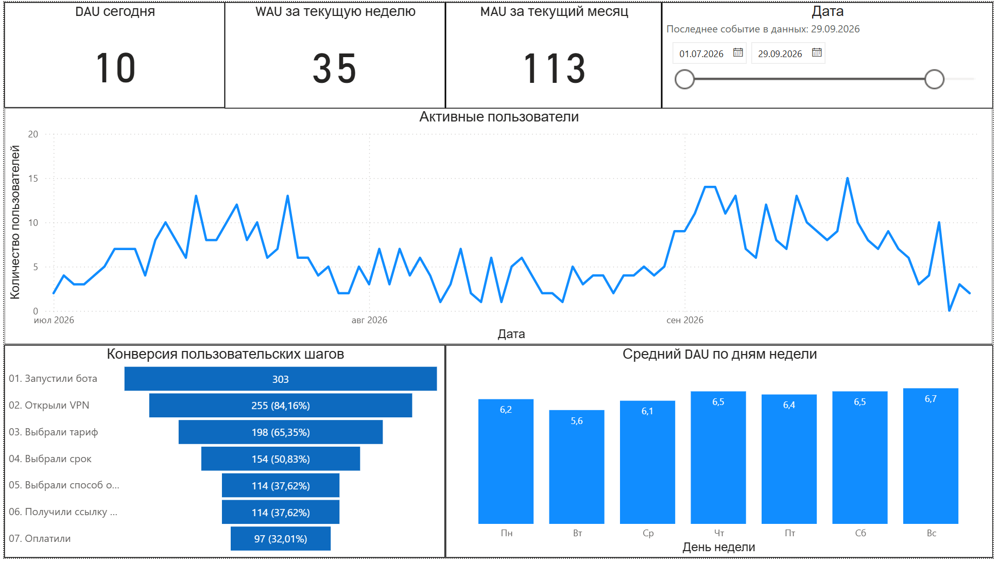
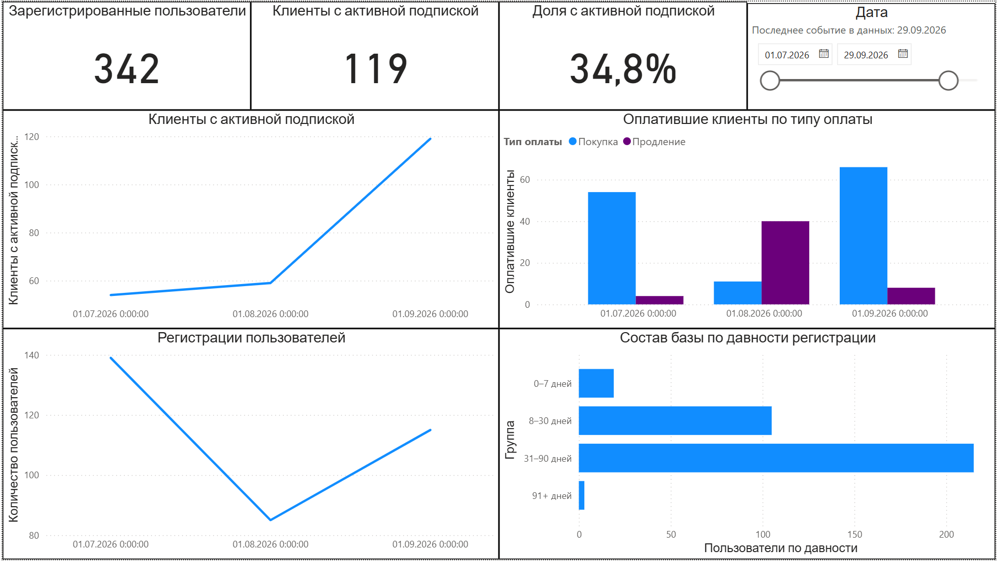
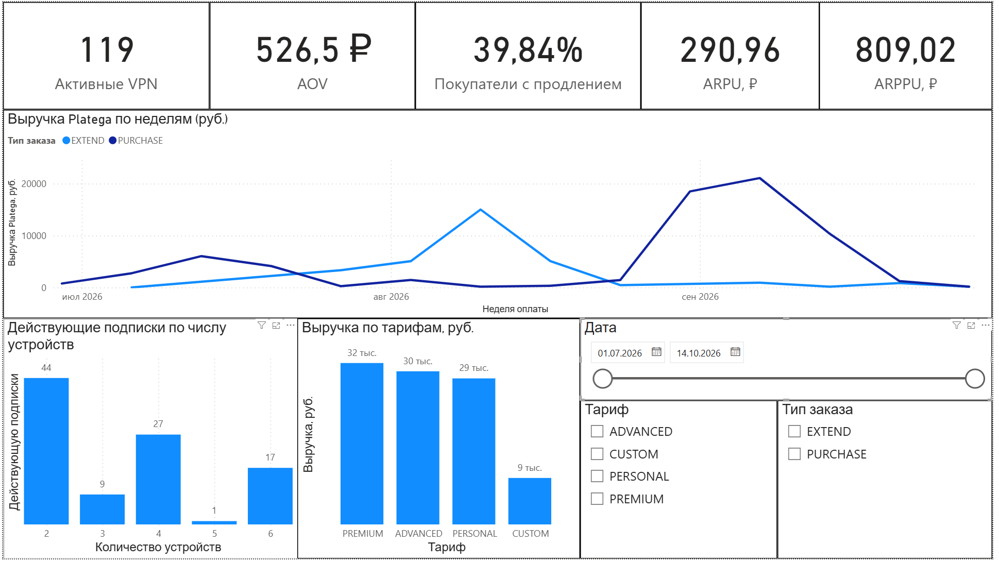
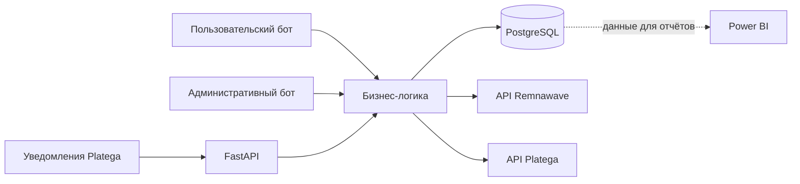

# LinkOut VPN

Сервис управления VPN-подписками через Telegram: пользовательский и административный боты, обработка платежей, интеграция с VPN-панелью и аналитика в Power BI. В этом репозитории опубликованы описание и примеры отчётов; исходный код хранится отдельно.

## Ссылки

- [Telegram-бот](https://t.me/linkoutvpnbot)
- [Связаться в Telegram](https://t.me/ultrider)

## Возможности

- Выбор тарифа, оплата, активация и продление подписки через пользовательского бота.
- Подтверждение платежей администратором и обработка уведомлений платёжного провайдера.
- Создание и обновление доступа, срока подписки и лимита устройств через API Remnawave.
- Напоминания об окончании подписки, реферальные бонусы и заявки на выплаты.
- Аналитика пользовательских событий, заказов и подписок.

## Дашборды Power BI

Первые два снимка показывают данные **на 29 сентября 2026 года**; на отчёте по платежам срез дат установлен **с 1 июля по 14 октября 2026 года**. Надписи «сегодня», «текущая неделя» и «текущий месяц» на карточках активности относятся к выбранной дате анализа. DAU, WAU и MAU отражают активность **в Telegram-боте**, а не подключения к VPN.

### Активность пользователей

DAU, WAU и MAU; динамика активности; воронка от запуска бота до оплаты; средний DAU по дням недели.

### Клиентская база

Число зарегистрированных пользователей и активных подписок, доля клиентов с активной подпиской, регистрации и платящие клиенты по месяцам, состав базы по давности регистрации.

### Платежи и тарифы

Активные подписки, средний чек (AOV), доля покупателей с продлением, ARPU и ARPPU; недельная выручка Platega по покупкам и продлениям, выручка по тарифам и распределение действующих подписок по числу устройств.

## Технологии и архитектура

**Python 3.12 · FastAPI · aiogram 3 · SQLAlchemy 2 / asyncpg · PostgreSQL · Alembic · Docker Compose · pytest · Power BI**

Пользовательский бот, административный бот и FastAPI запускаются как отдельные процессы. Они используют общую бизнес-логику и PostgreSQL. FastAPI принимает в том числе платёжные уведомления; сервис обращается к API Platega и Remnawave. Для аналитики события и данные о подписках сохраняются в PostgreSQL; часть аналитических наборов подготовлена представлениями БД, а отчёты собраны в Power BI.

Миграции схемы выполняются через Alembic. Проверки написаны на pytest и запускаются в GitHub Actions.

## Доступ к коду

Исходный код находится в приватном репозитории. Доступ предоставляется индивидуально через приглашение в GitHub.
