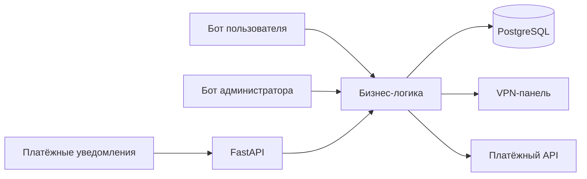

# LinkOut VPN

Сервис подписок на VPN с Telegram-ботами для пользователей и администраторов. Этот репозиторий — публичное описание проекта для портфолио. Исходный код хранится отдельно и предоставляется по запросу.

## Что делает сервис

- Проводит пользователя через выбор тарифа, оплату, активацию и продление подписки.
- Поддерживает административное подтверждение платежей и автоматическую обработку уведомлений платёжного провайдера.
- Синхронизирует доступ и лимиты устройств с внешней VPN-панелью.
- Обрабатывает напоминания об окончании подписки, реферальные бонусы и обращения на выплаты.
- Собирает агрегированную аналитику заказов, подписок и пользовательского пути.

## Технологии и архитектура

**Python · FastAPI · aiogram · SQLAlchemy · PostgreSQL · Alembic · Docker Compose · pytest**

Ключевые решения: разделение пользовательского и административного интерфейсов, подтверждение оплаты до выдачи доступа, защита от повторной обработки платёжных уведомлений, миграции базы данных и автоматические тесты. В подготовленной версии проекта проходит 482 теста.

## Доступ к коду

Код находится в приватном репозитории. Если вы рассматриваете проект в рамках собеседования, запросите доступ через контакт из моего резюме. Для совместной работы потребуется аккаунт GitHub и приглашение в репозиторий.

---

*LinkOut VPN is a Telegram based subscription platform with a FastAPI backend, PostgreSQL, payment flows, VPN panel integration, and automated tests. Source code is available to recruiters on request.*
